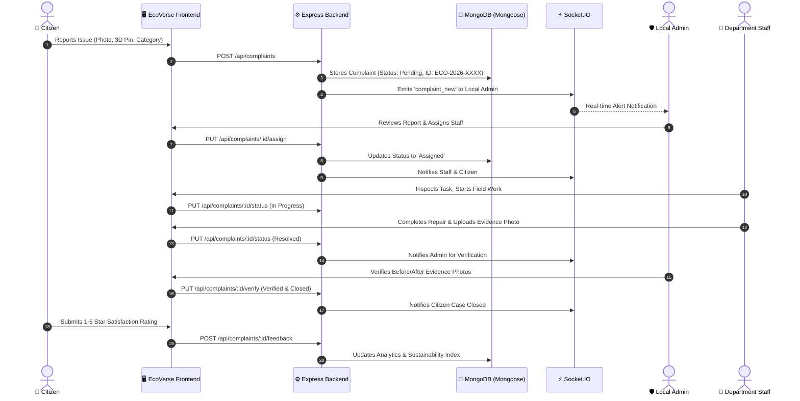

# 🌿 EcoVerse AI — Smart Village & Smart City Management Platform

> **A unified, real-time, 3D geospatial civic governance platform connecting citizens, municipal departments, and administrators across Smart Cities and Smart Villages in ONE centralized system.**

---

## 🌟 Executive Summary

**EcoVerse AI** bridges modern smart-city administration with rural smart-village development. Rather than disjointed prototypes or static landing pages, EcoVerse AI operates on a **single shared backend, common database, real-time Socket.IO notification network, and role-based access control (RBAC)** across four core operational modules:

1. **SmartSathi** — Complete citizen complaint management with photos, voice speech-to-text, 3D coordinates, and full resolution lifecycle.
2. **EcoMind** — Smart waste management powered by multi-modal AI material classification, ultrasonic bin hotspots, and before/after cleanup verification.
3. **JalRakshak** — Smart water network monitoring reservoir capacities, flow rates, pipeline pressure, water quality index (pH, turbidity, chlorine), and leak mitigation.
4. **EnergyGuard** — Clean energy & smart grid tracking solar photovoltaic arrays, battery storage, and an interactive LoRaWAN smart streetlight mesh.
5. **EcoVerse 3D World (EcoMap 3D)** — Interactive Three.js/React Three Fiber 3D environment rendering both urban towers and rural homesteads, animated EV transport, telemetry assets, and database-linked complaint markers.
6. **EcoAI Assistant** — Multilingual civic AI assistant supporting **English, Hindi (हिन्दी), and Odia (ଓଡ଼ିଆ)** with anti-hallucination database verification.

---

## 🏗️ System Architecture & Workflow



---

## 👥 Pre-Configured Demo Accounts (Zero-Friction Evaluation)

The platform includes an instant **Quick Role Switcher** dropdown in the top navigation bar. Alternatively, login with these pre-seeded accounts:

| Role | Email | Password | Responsibilities |
|---|---|---|---|
| **Super Admin** | `superadmin@ecoverse.gov` | `Admin@1234` | Platform governance, system health, user roles, full audit logs |
| **Local Admin** | `localadmin@ecoverse.gov` | `Admin@1234` | Review incoming complaints, assign staff, verify resolution proof, close tickets |
| **Water Staff** | `staff.water@ecoverse.gov` | `Staff@1234` | JalRakshak water pipeline repair, reservoir monitoring, upload leak evidence |
| **Waste Staff** | `staff.waste@ecoverse.gov` | `Staff@1234` | EcoMind garbage collection, hotspot clearing, before/after evidence photos |
| **Energy Staff** | `staff.energy@ecoverse.gov` | `Staff@1234` | EnergyGuard streetlights, solar inverter maintenance, power grid repair |
| **Civic/Roads Staff** | `staff.civic@ecoverse.gov` | `Staff@1234` | Pothole restoration, storm drainage desilting, sidewalk maintenance |
| **Citizen User** | `citizen@ecoverse.gov` | `Citizen@1234` | Report civic hazards, voice speech-to-text, 3D pin dropping, rating feedback |

---

## 🛠️ Technology Stack

### Frontend
- **Framework:** React 18 with Vite
- **3D Geospatial Engine:** Three.js, `@react-three/fiber`, `@react-three/drei`
- **Styling:** Tailwind CSS, Glassmorphism design system
- **Routing:** React Router v6
- **Analytics & Data Viz:** Recharts (Bar, Area, Pie charts)
- **Icons:** Lucide React
- **Real-Time Gateway:** Socket.IO Client
- **HTTP Client:** Axios (with automatic Bearer JWT interceptor)

### Backend
- **Runtime:** Node.js (ES Modules)
- **Server Framework:** Express.js
- **Database:** MongoDB with Mongoose
- **Zero-Dependency Fallback:** Embedded `MongoMemoryServer` (the server starts instantly with 100% functionality even if local MongoDB daemon is not installed!)
- **Real-Time Engine:** Socket.IO server with room-based pub/sub
- **Security:** JWT authentication, bcryptjs password hashing, role-based authorization middleware (RBAC)
- **AI Integrations:**
  - Multi-modal Vision API for waste classification
  - Contextual multilingual EcoAI assistant in English, Hindi, and Odia
  - Strict anti-hallucination database lookup for complaint queries

---

## 🚀 Quick Start & Installation

### 1. Prerequisites
- **Node.js:** v18+ (tested on Node v24.18.0)
- **npm:** v9+

### 2. Install Dependencies
```bash
# In the project root:
cd server && npm install
cd ../client && npm install
```

### 3. Start Backend & Database
```bash
cd server
npm run dev
```
*Note: The backend automatically checks for MongoDB. If a local instance is found at `mongodb://127.0.0.1:27017/ecoverse`, it connects; otherwise, it boots an in-memory replica automatically. On first boot, it self-seeds all 7 demo accounts, 5 departments, complaints, and live telemetry!*

### 4. Start Frontend
```bash
cd client
npm run dev
```
Open **`http://localhost:5173`** in your browser.

---

## 🧪 Automated Testing

EcoVerse AI includes an automated backend test suite verifying the end-to-end civic lifecycle:
```bash
cd server
npm test
```
**Test Results:**
- ✔ 1. Citizen User Authentication & Password Hashing Verification
- ✔ 2. Complaint Creation & Unique ID Generation Workflow (`ECO-YYYY-XXXX`)
- ✔ 3. Admin Assignment & Staff Progress Workflow
- ✔ 4. Staff Resolution, Evidence Upload & Admin Verification
- ✔ 5. Citizen Feedback Rating Submission
- ✔ 6. Notification Persistence & Retrieval

---

## 📡 REST API Reference

| Method | Endpoint | Access | Description |
|---|---|---|---|
| `POST` | `/api/auth/login` | Public | Authenticates user and returns JWT |
| `POST` | `/api/auth/register` | Public | Registers a new citizen user |
| `POST` | `/api/auth/demo-login` | Public | Instant 1-click role switcher for evaluation |
| `GET` | `/api/auth/me` | Authenticated | Fetches current user profile |
| `GET` | `/api/complaints` | Public / Auth | List complaints with category/department/status filters |
| `GET` | `/api/complaints/:id` | Public / Auth | Get complaint details, history, work notes, evidence |
| `POST` | `/api/complaints` | Citizen / Auth | Submit a new complaint with photos & 3D coordinates |
| `PUT` | `/api/complaints/:id/assign` | Admin | Assigns complaint to department staff member |
| `PUT` | `/api/complaints/:id/status` | Staff / Admin | Updates status (In Progress, Resolved) with evidence |
| `PUT` | `/api/complaints/:id/verify` | Admin | Admin verifies evidence & officially closes case |
| `POST` | `/api/complaints/:id/feedback` | Citizen | Submits 1-5 star service rating & review |
| `PUT` | `/api/complaints/:id/reopen` | Citizen / Admin | Reopens persisting issue with reason |
| `PUT` | `/api/complaints/:id/reject` | Admin | Rejects invalid complaint with reason |
| `POST` | `/api/waste/classify` | Public / Auth | Computer vision waste classification |
| `GET` | `/api/waste/hotspots` | Public | Returns smart bin fill levels and vehicle routes |
| `GET` | `/api/water/telemetry` | Public | Returns reservoir storage, line pressure, WQI |
| `GET` | `/api/energy/telemetry` | Public | Returns solar kW, battery %, streetlight status |
| `POST` | `/api/ai/chat` | Public / Auth | Multilingual EcoAI assistant (EN, HI, OR) |
| `GET` | `/api/analytics` | Public | Live KPI counters, resolution times, sustainability index |
| `GET` | `/api/notifications` | Authenticated | Real-time notifications for user or role |
| `PUT` | `/api/notifications/:id/read` | Authenticated | Marks notification as read |

---

## 🌐 Environment Configuration (`server/.env`)

```env
PORT=5000
MONGODB_URI=mongodb://127.0.0.1:27017/ecoverse
JWT_SECRET=ecoverse_super_secure_jwt_secret_key_2026_dev
NODE_ENV=development

# Optional External AI API Keys (Built-in civic heuristic engines operate seamlessly when omitted)
GEMINI_API_KEY=
OPENAI_API_KEY=
```

---

## 📦 Production Build & Fullstack Deployment

1. Build the React client:
   ```bash
   cd client
   npm run build
   ```
2. Start the Express server:
   ```bash
   cd ../server
   npm start
   ```
The Express server automatically serves the compiled Single Page Application from `client/dist` alongside the REST API and Socket.IO gateway on port 5000.
